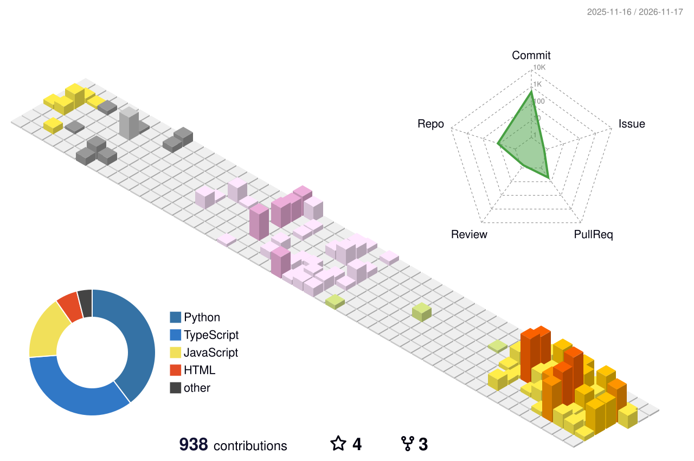

<!-- 머리 -->

  

  

  
  
  
  

 

##  소개

몰드베이스(사출금형 프레임)를 수입·판매하는 제조업 회사에서 사내 ERP(Django · PostgreSQL)를 개발하고 운영합니다.
구글 시트와 수작업으로 하던 물류 배차, 수입 인보이스·해외송금 서류, 세금계산서 발행을 ERP 로 옮겼고,
영업 현장용 웹 앱(Flutter PWA), 금형 CAD 설계검사 도구(MoldCheck), 사내 AI 도우미(Claude API)를 만들었습니다.
개선 결과는 현장 데이터와 대조해 확인하고, 운영 장애는 원인을 고친 뒤 회귀 테스트를 붙여 재발을 막습니다.

- 🏢 유한회사타이거몰드앤베이스 기업부설연구소(TLAB) 연구원 · 2026.08 \~ 재직 중
- 🎓 선문대학교 컴퓨터공학부 · 2027.02 졸업 예정
- 🏆 2026 국토교통 데이터활용 경진대회 대상 외 공모전 수상 3회
- 📜 정보처리기사 필기 · GAIQ · ADsP

 

##  기술

<table>
  <tr>
    <td width="130" align="center"><b>실무 · 백엔드</b></td>
    <td>
      
      
      
      
      
      
    </td>
  </tr>
  <tr>
    <td width="130" align="center"><b>실무 · 자동화</b></td>
    <td>
      
      
      
      
      
    </td>
  </tr>
  <tr>
    <td width="130" align="center"><b>실무 · 운영</b></td>
    <td>
      
      
      
      
      
    </td>
  </tr>
  <tr>
    <td width="130" align="center"><b>개인 프로젝트</b></td>
    <td>
      
      
      
      
      
      
      
      
      
      
      
    </td>
  </tr>
</table>

 

##  경력

### 유한회사타이거몰드앤베이스 · 기업부설연구소(TLAB) 연구원

`2026.08 ~ 재직 중` `사내 ERP 개발·운영`

중국 협력 제조사 3곳, 국내 운송사와 견적 → 수주 → 생산 → 물류 → 정산을 사내 ERP 하나로 운영하는 회사입니다.
현업 담당자의 요청을 실측 데이터로 확인하는 것부터 설계, 구현, 테스트, 운영 배포, 장애 대응까지 맡고 있습니다.
회사 저장소는 비공개라 링크가 없습니다.

<table>
  <tr>
    <th>ERP 규모</th><th>2026.08 입사 시</th><th>2026.10 말</th>
  </tr>
  <tr><td>Python 코드</td><td align="right">18,458줄</td><td align="right"><b>101,769줄</b></td></tr>
  <tr><td>자동 테스트</td><td align="right">48개</td><td align="right"><b>2,097개</b></td></tr>
  <tr><td>Django 앱</td><td align="right">5개</td><td align="right"><b>8개</b></td></tr>
</table>

3개월 동안 ERP 커밋 562건 · 영업 웹 앱 커밋 77건(모바일 API 경로 74개) · MoldCheck 커밋 84건

**주요 성과**

| 무엇을 | 전 → 후 | 어떻게 |
|---|---|---|
| 수입신고필증 ↔ 인보이스 자동 매칭 | **93% → 99.1%** (오매칭 0) | 실측 113건의 날짜 분포로 매칭 기간을 좁히고 건수가 맞을 때만 1:1 배정 |
| 해외송금 1건 은행 제출 서류 작성 | **45\~75분 → 4.3초 + 검토** | 은행 xlsx 양식을 서식 보존한 채 채우고 날인·서류 묶음 자동화 |
| 입항일 하루치(86건) 배차 | **3.5\~5시간 → 58초 + 검토** | OR-Tools CVRP 배차를 ERP 로 이관 |
| 배차 미배차율 | **9.9% → 0.6%** | 운송사 실배차 4,115건과 대조해 규칙 오류 수정 |
| 국내 운송비 견적 정확도 | **실제 청구 대비 중앙 1.02배** | 운송사 청구 1,337건 분석, 시군구 × 차량등급 요율표(1,547행) |
| 세금계산서 발행 | **수작업 5단계 → 국세청 실발행** | 하이웍스 전자세금계산서 API 연동, 과거 41,153줄 소급(금액 오차 0) |
| 운영 배포 | **수동 8단계 → 명령 1줄** | worktree 사전 검사·자동 백업·위험 마이그레이션 차단·무중단 재기동 |
| 트랜잭션 정합성 | **결함 47건 발견 → 35건 수정** | ERP 6개 영역 감사, 회귀 테스트 121건 추가 |
| 견적 세부 화면 (47행) | **78.5초 → 1.6초** | HTML 요소 114,239 → 3,401개 |
| 견적 수정 화면 (상품 20개) | **쿼리 853 → 76** | N+1 쿼리 제거 |
| 운송사 청구 대조 결제 오분류 | **47대 중 17대 → 3대** | 합쳐서 청구하는 차를 N:1 매칭으로 |
| 사내 AI 도우미 보고서 숫자 | **LLM 숫자 오기 차단** | Claude API tool use, 표·차트 숫자는 서버가 SQL 재실행으로 채움 |

<b>경력기술서 요약 (문제 → 해결 → 성과)</b>

 

**🚚 물류·배차 ERP 이관 · 운송사 협업 화면** `2026.08 ~ 10`
- 문제: 배차가 구글 시트와 담당자 PC 의 파이썬 스크립트로 돌아가 ERP 와 분리돼 있었고, 운송사와는 엑셀·카톡으로 차량·운임을 주고받았습니다.
- 해결: 착지·입항(B/L)·화물·배차 계획을 모델링하고 OR-Tools CVRP 최적화를 이관했습니다. 납품일 → 좌표 → 최적화 → 운송사 회신 → 확정을 한 화면으로 묶고, 확정 시 운송 기록·운송비에 자동 반영합니다. 외부 운송사 계정은 허용 목록 미들웨어로 전용 화면만 통과시킵니다.
- 성과: 86건 자동 배차 58초 · 미배차 9.9% → 0.6% · 결제 오분류 17대 → 3대

**📦 국내 운송비 견적 체계 재설계** `2026.08`
- 문제: 견적 물류비가 실제 청구와 크게 달라 영업이 근거를 댈 수 없었습니다.
- 해결: 배차 내역서 1,337행을 분석해 청구가 예측 문제가 아니라 '도착지 시군구 × 차량등급 + 경유비' 구조임을 확인하고, 중량 구간표를 요율표(17시도·204구역·1,547행)로 바꿨습니다. 적용일별로 요율을 쌓아 과거 견적을 재현할 수 있게 했습니다.
- 성과: 견적이 실제 청구 대비 중앙 1.02배 · 차량 1대 청구 재현 wMAPE 8.1% → 6.2% · 회귀 예측모델(7.5%)과 비교해 설명 가능한 규칙 엔진 유지를 데이터로 결정

**🧾 수입 인보이스·해외송금·통관 서류 자동화** `2026.08 ~ 09`
- 문제: 협력사 인보이스가 61열 스프레드시트로 관리돼 중복 기재·부분결제 이중 합산이 있었고, 은행 제출 서류를 매번 손으로 만들었습니다.
- 해결: PDF 파서와 스캔본 OCR 로 인보이스를 명세 단위로 적재하고, 스캔 필증은 이중 압축 층(MRC)에서 글자층을 골라 OCR 합니다. 공통 식별자가 없어 업체 + 금액 + 시기로 매칭하는데, 인보이스일이 신고일보다 늘 2\~5일 앞선다는 것을 찾아 매칭 기간을 ±45일 → −14\~+3일로 좁혔습니다. 은행 양식은 xlsx(zip) 안 워크시트 XML 만 고쳐 도형·서식을 보존합니다.
- 성과: 필증 자동 매칭 99.1% · 스캔 필증 OCR 213/213 (파일당 1.7\~2초) · 명세–상품 자동 연결 6분 → 1초

**🏛️ 세금계산서 발행 ERP 내재화 · 국세청 실발행 연동** `2026.09`
- 문제: 발행이 수작업 5단계(납품 끝난 건 찾기 → 거래명세서 작성 → 확인 대기 → 홈택스 입력 → ERP 재입력)였고, 데이터에 승인번호·전송 상태를 둘 자리가 없었습니다.
- 해결: 문서 계층을 도입해 과거 데이터를 소급 묶고 발행 대기 → 거래명세서 → 확인 대기 → 발행 흐름을 만들었습니다. 하이웍스 API 는 국세청 비전송 모드로 왕복 검증했고, 멱등 키·전송중 상태·1분 폴링으로 이중 신고 없이 국세청 승인 지연에 대응합니다.
- 성과: 2026-09-29 국세청 실발행 가동 · 홈택스 목록 기준 세무 자료·ERP 대조 대시보드

**🤖 사내 AI 도우미 Tiger GPT** `2026.10`
- 목표: 직원이 ERP 안에서 데이터·업무 질문을 바로 묻되, DB 를 바꿀 수 없고 민감 정보가 새지 않으며 비용과 숫자를 믿을 수 있게 하는 것.
- 해결: Claude Messages API(tool use)에 SQL 조회·업무 설명서 검색·PDF 보고서 도구를 붙였습니다. 읽기 전용은 DB 접속 옵션과 SQL 검사 두 겹, 민감 표 차단, 월 예산·질문당 상한. 보고서 숫자는 서버가 다시 계산하고 요약 문장의 숫자는 도구 결과와 대조합니다.
- 성과: 실측에서 나온 숫자 오기(48% → 52%, 억·만 환산 오류)를 검증 단계가 돌려보내 모델이 스스로 고침 · 보고서 1건 23.7초·$0.05

**🛡️ 운영 안정성 — 무중단 배포 · 정합성 감사** `2026.10`
- 문제: 배포가 손 절차 8단계였고 재기동 중 502 로 저장 요청이 유실된 적이 있었습니다. 여러 표를 쓰는 작업에서 정합성이 깨지는 신고가 이어졌습니다.
- 해결: 배포 도구 — 별도 worktree 사전 검사, 자동 백업, 옛 코드를 깨는 마이그레이션 거부(판정 못 하면 거부), 화면 렌더 확인, 무중단 재기동. 설계는 적대적 검토 3회로 데이터 손상 경로를 걷어냈습니다. 다단계 쓰기의 트랜잭션 경계·행 선점·미러 상태 동기화를 고쳤습니다.
- 성과: 배포 8단계 → 1줄 · 정합성 결함 35건 수정, 회귀 테스트 121건

**📱 영업 웹 앱(Flutter PWA) · ERP 모바일 API** `2026.09`
- 운영 서버에 새 패키지 없이 순수 Django 뷰로 모바일 API(기기 토큰·버전 게이트·멱등 쓰기)를 만들고, 방문 동선 플랜 엔진(최근접 + 2-opt), 무게별 납기 계산기(중국 제작 구간은 중국 휴일, 한국 납품 구간은 한국 휴일로 따로 계산), 음성 메모 요약을 붙였습니다.
- 성과: 5일 만에 설계·구현·운영 배포 (API 경로 74개 · 테스트 107개)

 

##  회사 제품

### MoldCheck — 금형 CAD 설계검사 도구

`2026.09 ~` · [판매 사이트](https://leejaehaeng.github.io/moldcheck-site/)

서버 없이 브라우저 단일 HTML 로 동작하는 검사기입니다. Parasolid(x_t·x_b)·NX .prt·STEP 을 외부 CAD 커널 없이 자체 파서로 읽어 홀·체결부 설계 오류를 근거 등급과 함께 알려 줍니다(검사 규칙 26개).

- 정답을 아는 합성 모델로 측정 — 홀 인식 재현율·정밀도 **100%**(52홀), 판 역할 인식 **100%**(49/49), 지표가 떨어지면 빌드 중단
- 고객 3D 도면 696개로 파서 결함을 고쳐 경고 없이 열리는 파일 **82% → 97%**, 열리던 파일 회귀 0건
- 열리지 않던 105MB NX 도면(Parasolid 29.1, 노드 158만 개)의 문서화되지 않은 구조를 실측으로 해석해 **23초**에 열고 오탐 **156 → 0건**
- 사내용·평가판·판매본 3종 빌드 분리, Ed25519 라이선스, 배포물 금지 문자열 검사로 API 키·GPL 코드 유출을 빌드 단계에서 차단

   

### ERP 업무 자동화 파이프라인

`2026.11 ~` `운영 미배포 · 섀도우 검증 단계`

견적 요청 메일 → 견적 → 수주 → 출하·통관 → 배차 → 세금계산서까지 사람 손이 들던 구간을 자동화하는 개발 브랜치입니다.

- 기능마다 `off → shadow → delay → on` 스위치 + 환경 관문 + 코드 상한의 3중 안전장치, 자동 경로가 사람 경로와 같은 함수만 부르게 해 리플레이 판정 **412/412** 일치
- 과거 메일 리플레이로 견적 요청 포착률 **70.7% → 98.3%**
- 위챗 단톡방 출하 명세·B/L 자동 반영 — 직원이 직접 입력한 값과 314칸 비교에서 불일치 **0건**

 

##  개인 프로젝트

### 청년 안심 H+T 추천 시스템
 `2026.05` `1인 풀스택` · [서비스](https://youth-ht-web.vercel.app) · [GitHub](https://github.com/LeeJaeHaeng/youth-ht)

2026 국토교통 데이터활용 경진대회 대상. 월세·통근·HUG 보증사고 위험·6개월 뒤 부담을 함께 본 거주지 Top 10 추천 — XGBoost 월세 예측 MAE 61,449원, GRU 6개월 부담률 예측.

     

### 천안시 AI 파킹패스
 `2025.12 ~ 2026.01` `1인 풀스택` · [서비스](https://cheonan-parking-ai.web.app) · [GitHub](https://github.com/LeeJaeHaeng/parking_pass)

2025 천안시 스마트시티 AI 아이디어 공모전 최우수상. 공영주차장 105곳 데이터와 시간대·요일·날씨 등 8개 요소로 혼잡도를 예측해 지도 기반으로 추천.

    

### Step-by-Step
 `2026.03 ~ 04` `1인 풀스택` · [서비스](https://step-by-step-app-navy.vercel.app) · [GitHub](https://github.com/LeeJaeHaeng/Step-By-Step)

2026 전국 통합데이터 활용 공모전 장려상. 구직을 쉬는 청년에게 실행 가능한 퀘스트 추천 — 외부 API 9종, 20초 타임아웃·fallback·캐시로 장애 때도 기본 추천 유지.

   

### HONORS(아너스)
 `2026.09 ~ 10` `1인` `비공개 저장소`

Google Play 정식 출시(2026-10-08), App Store 4.3(b) 반려 → 이의 제기 승소(10-19). 승인제 골프 라운드 소셜 앱 — 커밋 371건, 서버 회귀 테스트 505건 + 앱 테스트를 배포 관문으로, 모든 테이블 RLS.

   

### 네컷홈(4cut_home)
 `2026.09` `1인` `비공개 저장소`

착수 4일째 App Store 1.0 출시(2026-09-19). 네컷 사진을 친구 그룹 '미니룸'에 모으는 앱 — Cloud Functions 24개, E2E 3라운드 연속 36/36.

  

### AlgaeCast-7
 `2026.10 ~ 11` `1인` · [서비스](https://algaecast-7.vercel.app) · [GitHub](https://github.com/LeeJaeHaeng/AlgaeCast)

유해남조류 7일 예측 — LightGBM 앙상블 RMSE(log) 0.712(지속성 예측 대비 약 20.6% 개선), 2026년 경계 사건 8건 중 7건을 중앙 21일 앞서 포착, 매일 자동 수집·추론.

   

### FlatLoad
 `2026.03 ~ 06` `교내 팀 프로젝트` · [서비스](https://flatroad-app.vercel.app) · [GitHub](https://github.com/LeeJaeHaeng/4.1_FlatLoad)

전동휠체어·전동스쿠터 이용자 접근성 내비게이션. AI 장애물 탐지 결과를 관리자 승인·투표 신뢰도로 걸러 안전 경로에 반영 — 백엔드 팀원 이탈 후 핵심 기능 3가지를 맡아 마감 안에 완성.

   

<b>그 밖의 프로젝트</b>

 

| 프로젝트 | 내용 | 링크 |
|---|---|---|
| ER-Navi | E-GEN 공공데이터로 실시간 병상·중증 수용성·거리를 반영한 응급의료기관 추천 | [서비스](https://er-navi.vercel.app) · [GitHub](https://github.com/LeeJaeHaeng/4.1_ER-Navi) |
| CakeFlow | 케이크 주문서·시뮬레이터·관리자 콘솔·알림톡/SMS fallback·작업지시서 PDF 를 묶은 주문 관리 플랫폼 | [서비스](https://cakeflow-mu.vercel.app) · [GitHub](https://github.com/LeeJaeHaeng/Cakeflow) |
| HuLife | 시니어 AI 취미 추천·모임·실시간 채팅·일정 관리를 묶은 웹 + 모바일 플랫폼 | [시연](https://youtu.be/lC-TkHRQ6R0) · [GitHub](https://github.com/LeeJaeHaeng/3.2_HuLife-App) |
| VoiceShield AI | 보이스피싱·딥보이스·딥페이크 이미지를 탐지하는 모바일 앱 | [시연](https://youtube.com/shorts/3D3rc5xtZYk) · [GitHub](https://github.com/LeeJaeHaeng/3.2_VoiceShield_AI) |

 

##  학력 · 수상 · 자격

| 구분 | 내용 | 시기 |
|---|---|---|
| 🎓 학력 | 선문대학교 컴퓨터공학부 (졸업 예정) | 2023.03 \~ 2027.02 |
| 🏆 수상 | 2026 국토교통 데이터활용 경진대회 **대상** (국토교통부) | 2026.07 |
| 🥉 수상 | 2026 전국 통합데이터 활용 공모전 **장려상** (행정안전부) | 2026.05 |
| 🥈 수상 | 2025 천안시 스마트시티를 위한 AI 아이디어 공모전 **최우수상** | 2026.01 |
| 📜 자격 | 정보처리기사 필기 합격 | 2026.06 |
| 📜 자격 | GAIQ (Google Analytics Individual Qualification) | 2026.04 |
| 📜 자격 | 데이터분석준전문가 ADsP | 2025.09 |

 

##  GitHub 활동

  <picture>
    <source media="(prefers-color-scheme: dark)" srcset="profile-3d-contrib/profile-night-rainbow.svg" />
    
  </picture>

  

  
  

사용 언어 카드는 공개 저장소만 집계합니다 — 회사 업무(Python·Django)는 비공개 저장소에 있습니다.

<!-- 꼬리 -->

2026.11.17 수정 · 경력 수치는 2026.10.31 기준

